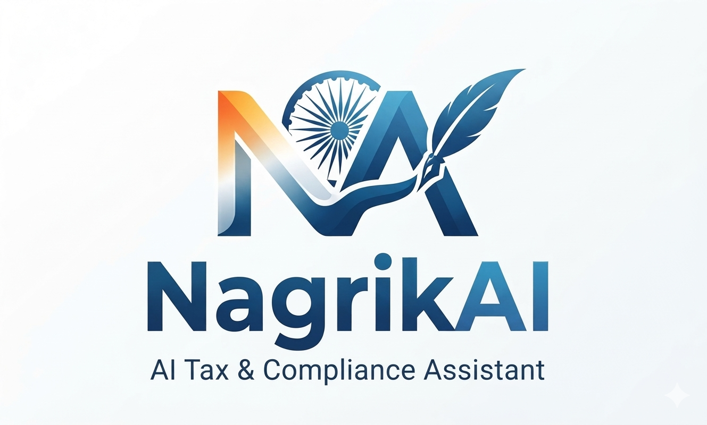

<p align="center">
  
</p>

# NagrikAI

NagrikAI is an experimental assistant for Indian tax and business compliance questions. It crawls configured government websites, converts pages into a searchable local collection, and uses an LLM agent to answer questions with source links. The agent can also calculate, read PDFs, look up standard filing dates, and suggest a small set of MSME schemes for review.

The Gradio interface shows the conversation, sources, agent steps, and claim checks. Answers and calculated dates can be wrong or outdated; verify decisions and deadlines against regulator sources.

## Requirements

- Python 3.14 and [uv](https://docs.astral.sh/uv/) (recommended).
- [Ollama](https://ollama.com/) with a local model, or an OpenRouter API key.
- Network access to crawl sites and download embedding and local reranker models on first use. The initial download and app startup can take time.

## Get started

From the repository root, install dependencies and create a local configuration:

```bash
uv sync
cp .env.example .env
```

Edit `.env` before starting. For a local setup, keep `NAGRIKAI_LLM_PROVIDER=ollama` and the example's local reranker settings. Start Ollama and download the configured model:

```bash
ollama serve
# In another terminal:
ollama pull qwen2.5:7b
```

The example `.env` includes placeholder API keys. Remove or replace them before using those services. For OpenRouter, set `NAGRIKAI_LLM_PROVIDER=openrouter`, `NAGRIKAI_OPENROUTER_API_KEY`, and `NAGRIKAI_OPENROUTER_MODEL` in `.env`. See [`.env.example`](./.env.example) for other settings.

Build the local search collection, then launch the web app:

```bash
uv run nagrik-ai crawl sites --site gst --site gst_tutorial
uv run nagrik-ai parse all
uv run nagrik-ai vectorize
uv run nagrik-ai app-command
```

Open the local URL printed by Gradio (port 7860 by default). Omit `--site` to crawl all configured sites. If `content/` already has parsed documents, you can run `vectorize` without crawling again. The crawler writes to `content/<site>/crawled/`, the parser writes to `content/<site>/parsed/`, and the vectorizer stores embeddings in `chroma_db/` by default. Source definitions live in [`nagrik_ai/config/site_configs.yaml`](./nagrik_ai/config/site_configs.yaml).

## CLI commands

| Command | Purpose |
| --- | --- |
| `uv run nagrik-ai --help` | Show commands and options. |
| `uv run nagrik-ai crawl sites` | Crawl configured sources; select one with `--site NAME`. |
| `uv run nagrik-ai parse all` | Convert crawled HTML to Markdown. |
| `uv run nagrik-ai vectorize` | Index parsed Markdown in ChromaDB. |
| `uv run nagrik-ai app-command --port 7860` | Start the Gradio interface. |
| `uv run nagrik-ai agent chat "What is the QRMP scheme?"` | Ask the agent from the terminal. |
| `uv run nagrik-ai agent chat "Start" --interactive` | Start a multi-turn terminal session; use the printed ID with `--session` to resume. |

The agent routes among local document search, Tavily web search, PDF reading, a calculator, a tax calculator, a standard compliance date calculator, and a small source-linked MSME scheme catalogue. Web search needs `NAGRIKAI_TAVILY_API_KEY` (or `TAVILY_API_KEY`). Scheme matches are candidates, not eligibility determinations. Compliance dates are baseline rules and do not include later extensions or notices.

The web app accepts PDF uploads and displays citations where the answer provides them. Conversation checkpoints and business profiles are stored under `checkpoints/` by default.

## How it works

1. The Scrapy crawler collects pages listed in the site configuration.
2. The parser converts HTML to Markdown, and the vectorizer chunks and embeds it in ChromaDB.
3. Retrieval combines dense search with optional BM25 search and reranking. The default result count is five (`NAGRIKAI_TOP_K`), selected from up to 20 candidates (`NAGRIKAI_FETCH_K`).
4. The LangGraph agent selects tools, checks evidence, drafts an answer, and checks claims. When validation cannot complete, the interface marks the answer with limitations.

The indexed collection covers only pages you have crawled and parsed. It is not a complete or automatically current record of Indian law. Web search can supplement the collection but its results also need verification.

## Development and evaluation

```bash
uv run pytest
uv run ruff check .
uv run mypy nagrik_ai
uv run nagrik-eval validate-datasets
uv run nagrik-eval deepeval run --offline --limit 5
```

The evaluation CLI also supports `nagrik-eval agent run`; see `uv run nagrik-eval --help` for options. Online evaluation uses a configured judge model. Datasets and rubrics are under [`evaluation/`](./evaluation/).

<p align="center">
  
</p>
